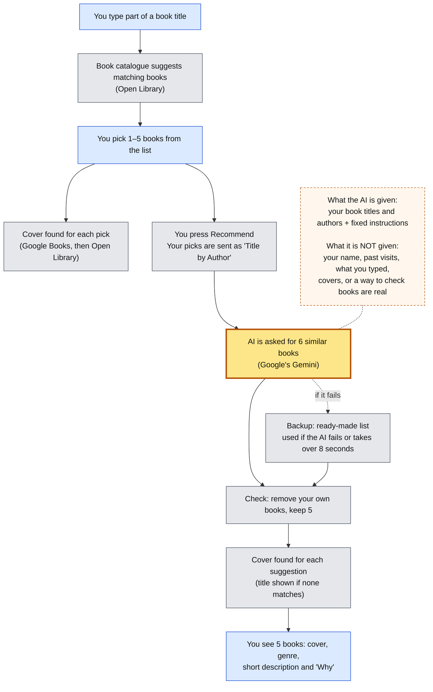

# How Babel works

Babel suggests new books based on 1–5 books you already love.

**Key:** blue = you · grey = always works the same way · yellow = AI, results can vary · dashed = what the AI sees

## Walkthrough

**1. You start typing.** As you type a title, Babel asks Open Library, a free online book catalogue, for up to 6 matching books. It's a plain search with no AI, so the same words always give the same kind of results.

**2. You pick your favourites.** You choose 1–5 books from the suggestions. Only books you pick are used. Whatever else you typed in the search box goes nowhere.

**3. Covers for your picks.** For each book you pick, Babel looks for a cover on Google Books, then on Open Library. It prefers older editions and skips movie posters. There's no AI in this step.

**4. You press Recommend.** Babel sends your picks to the AI as a simple list, like "Dune by Frank Herbert".

**5. The AI suggests books. This is the only part that can vary.** Google's Gemini AI is asked for 6 books similar to yours. Its fixed instructions say: don't suggest the user's own books, put first the books that connect to several of the user's favourites, and give each one a simple genre, a 1–2 sentence description with no spoilers, and a one-line reason. Because it's AI, the same picks can give different suggestions each time.

**6. What the AI knows, and what it doesn't.** The AI only sees your book titles and authors, plus the fixed instructions. It doesn't know who you are or what you picked last time, it doesn't see covers or anything else you typed, and it can't look anything up. All it has is what it already knows about books, so now and then it might get a detail wrong.

**7. Backup plan.** If the AI doesn't answer within 8 seconds or something goes wrong, Babel uses a ready-made list instead. It picks one of three lists (sci-fi, dystopian or general fiction) based on words in your titles. These suggestions are always the same.

**8. Final check.** Babel removes any of your own books that slipped through and keeps the first 5. It doesn't check that the suggested books really exist.

**9. Covers for the suggestions.** Babel looks for each cover the same way as in step 3. If no cover clearly matches the right book and author, it shows the title instead of guessing.

**10. What you get.** You get 5 books. Each has a cover, a genre, a short description and a "Why" line explaining how it connects to your favourites.

**A note on "agent":** Babel asks the AI one question and gets one answer. The AI doesn't take further steps, use tools or remember anything between visits.
